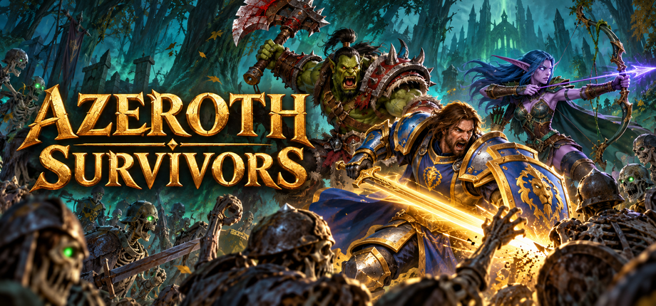

# Decky Web Games

Steam Deck용 웹게임 설치·제거 플러그인 / Web game launcher for Decky Loader.



## 한국어

**Pokebonk Online**과 **Azeroth Survivors**를 게임별 **Install / Uninstall** 버튼으로 관리합니다. Install을 누르면 Brave 브라우저 준비, Steam 바로가기, 네이티브 게임패드 설정과 라이브러리 이미지 등록을 진행합니다. 인터넷 연결이 필요합니다.

| 게임 | 공식 사이트 | 실행 방식 |
| --- | --- | --- |
| Pokebonk Online | https://pokebonk.com/ | Brave 전체화면 |
| Azeroth Survivors | https://wow.aethus.pl/ | 전용 Brave 프로필 · WebGPU/Vulkan |

### 설치

1. [릴리스 페이지](https://github.com/sunim87/decky-web-games/releases/latest)에서 **decky-web-games-v1.1.0.zip**을 다운로드합니다. `-source.zip`은 소스 코드 보관용입니다.
2. Decky Loader 설정의 개발자 메뉴에서 ZIP 설치 기능으로 설치합니다.
3. Decky에서 **Decky Web Games**를 열고 원하는 게임의 **Install**을 누릅니다.
4. Steam 라이브러리에서 해당 게임을 실행합니다.

기존 Brave가 있으면 재사용하며 없으면 공식 Flathub에서 설치합니다. 게임별 캡슐·넓은 캡슐·히어로·로고·아이콘을 등록합니다. 첫 실행 시 게임 데이터를 내려받는 동안 시간이 걸릴 수 있습니다.

### 조작 및 실행

Steam Deck 내장 컨트롤러에 네이티브 게임패드 설정을 적용합니다. 게임패드 식별에 필요한 `/run/udev` 읽기 권한도 실행 옵션에 포함합니다. 게임 화면이 활성화된 상태에서 버튼을 한 번 누르세요.

Azeroth는 왼쪽 스틱 이동, 오른쪽 스틱 시점 회전, A 점프, 범퍼·트리거 확대/축소를 지원합니다. 자세한 버튼 동작은 각 게임의 설정을 확인하세요.

Azeroth는 WebGPU용 Linux 그래픽 옵션과 별도 브라우저 프로필을 사용합니다. 전용 프로필에서는 Brave P3A 통계와 첫 실행 안내를 비활성화합니다. 일반 Brave 프로필은 변경하지 않습니다.

### 제거 및 데이터

게임을 종료한 뒤 해당 게임의 **Uninstall**을 누르세요. 관리 중인 바로가기와 라이브러리 이미지를 제거하며 **Brave, 로그인, 브라우저 프로필과 게임 저장 데이터는 보존**합니다. 다른 게임은 제거하지 않습니다.

Decky에서 플러그인만 삭제하면 게임 바로가기는 남습니다. 바로가기까지 지우려면 먼저 Uninstall을 실행하세요. 기존 설치 기록은 `~/.local/share/decky-pokebonk/`에 유지하며 Azeroth 기록은 그 아래 `azeroth/`에 저장합니다.

## English

Install and uninstall **Pokebonk Online** and **Azeroth Survivors** from Decky. Each game has its own buttons, Steam shortcut, native gamepad setup and five library images. Games load directly from their creators' websites and require internet access.

Download **decky-web-games-v1.1.0.zip** from [Releases](https://github.com/sunim87/decky-web-games/releases/latest), install it through Decky's ZIP installer, open **Decky Web Games**, and press the game's **Install** button. Launch it from the Steam library.

Brave is reused or installed from Flathub. Azeroth uses a dedicated profile with Linux WebGPU/Vulkan options and read-only `/run/udev` access. Its P3A notice is disabled in that dedicated profile. Browser sandboxing and certificate checks stay enabled.

Close the game before pressing **Uninstall**. Only the managed shortcut and library art are removed. Brave, browser profiles, login sessions, game saves and other games are kept. Removing the Decky plugin itself does not remove shortcuts.

## Validation

- 23 Python regression tests, frontend installation/rollback tests, typecheck and build passed.
- Physical Steam Deck Gaming Mode launch, AMD RDNA 2 WebGPU initialization, artwork, native gamepad selection and user-confirmed controls were tested.
- Uninstall/reinstall preserved the browser profile and local storage hashes; existing Pokebonk stayed available.
- Brave first-run infobar fix was verified after relaunch.
- Long-session stability, every physical button, external controllers and other hardware are not fully tested. See [VERIFICATION.md](VERIFICATION.md).

## Development

Node.js 20+, pnpm 11.25.0 and Python 3.11+:

```sh
pnpm install --frozen-lockfile
pnpm test
pnpm test:frontend
pnpm typecheck
pnpm build
python scripts/package_plugin.py
```

The install ZIP retains the existing `decky-pokebonk/` plugin directory and persistent data paths for updates. Steam/Decky internal APIs, games and browser behavior may change independently.

## Credits and license

PokéBonk is by Charcher; Azeroth Survivors is by Aethus. This plugin opens their official sites and does not redistribute game code or unlocked offline builds. Generated library artwork is fan artwork, not an official game screenshot. The Pokebonk PB icon originates from the game's bundled icon; the controller template is based on Steam's standard gamepad template.

Plugin code is [MIT licensed](LICENSE); this does not grant rights to game characters, artwork or trademarks. Unofficial community project, not affiliated with the game developers, Valve, Blizzard Entertainment, Nintendo, GAME FREAK, Creatures or The Pokémon Company.
